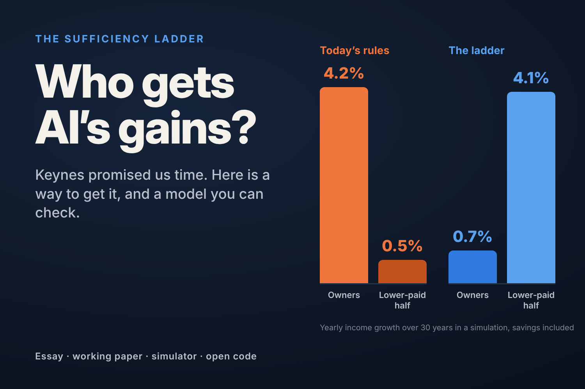

# The Sufficiency Ladder

A proposal for sharing AI's productivity gains with the people doing the work, with a working paper, an agent-based model, an interactive simulator and the code to check every number.

- **Essay:** [Keynes Promised Us Time. AI Is Our Second Chance.](https://rinsite.substack.com/p/keynes-promised-us-time-ai-is-our) (Substack; also in [essay/](essay/keynes-promised-us-time.md))
- **Working paper:** [paper/sufficiency-ladder-working-paper.pdf](paper/sufficiency-ladder-working-paper.pdf), version 5.1, 27 October 2026
- **Simulator:** [aj-fyc.github.io/sufficiency-ladder](https://aj-fyc.github.io/sufficiency-ladder/). Change the assumptions and rerun the model in your browser.



## The idea

When new technology adds profit, the company keeps a fixed share of the added profit after costs (10% in the model) and the rest goes to the people doing the work, half of it into personal capital accounts. People who approach financial sufficiency ("enough") cut their hours, and the hours they release pass to the next person in line. Owners keep their shares and today's profits; what they give up is most of the future growth.

## What the model finds, and what it doesn't

- **The split must come after costs.** If the company keeps 10% of gross gains but pays all the costs, only 7.6% of the AI value that would otherwise be built still gets built. A split of profit after costs leaves investment decisions unchanged, provided losses are shared as fully as gains.
- **The order of growth flips, and no class overtakes another.** In a 30-year simulation of 2,000 people and 20 owners, the lower-paid half's income grows 4.1% a year counting savings locked in capital accounts (2.3% counting only what they can spend), against 0.5% under today's rules; owners' grows 0.7%, against 4.2%.
- **Displaced hours become time.** Unemployment falls to zero by year 22, against 17% under today's rules by year 30, and the average week shortens to four days.
- **It has limits.** The voluntary handoff fails once more than about 43% of AI's gain shows up as fewer hours needed. An admission rule extends it for the 30 years simulated, but not indefinitely.
- **The institutions do the work.** A dividend with the same working-time rights and capital accounts does about as well, so in the model the results come from those rules, not from paying the share per hour worked.
- **It is not a forecast.** The model compares mechanisms under stated assumptions; Section 10 of the paper lists what it leaves out.

## Status and provenance

The idea is RI's. The literature review, model, simulation and drafting were done with Claude (Anthropic) under RI's direction. The paper and code have been through four rounds of review by other AI models (including Gemini and Codex), a full check of the references and an automated check of every model number. **No economist has reviewed it yet.** Critique is welcome: open an issue here or comment on the essay. The most useful next step is empirical: a pilot that measures how much of the work people release becomes stable jobs for newcomers.

## Reproduce and check the paper's numbers

```
mkdir -p out figs
node paper_numbers.js   # runs run.js (about a minute), then checks every number
python3 figs.py         # optional: redraws the figures; needs numpy and matplotlib
```

Requires Node 16 or later and Python 3.9 or later. No other dependencies. A default run of the four regimes takes about a quarter of a second.

## Files

- `index.html`: the simulator, served at the address above. It runs `model.js` in the page and needs no internet connection.
- `model.js`: the agent-based model (2,000 people and 20 owners over 30 years). Deterministic for a given seed. Runs in Node and in the browser.
- `run.js`: every scenario reported in the paper (248 runs). Writes `out/results.json`.
- `figs.py`: the paper's figures. Reads `out/results.json` and writes `figs/*.png`.
- `paper_numbers.js`: runs `run.js`, then makes 246 checks: every model number the paper reports, compared with the fresh run and rounded as the paper rounds it, plus the run count and a check that the four classes keep their order in every year of every run. Exit code 0 means every check passed.
- `paper/`: the working paper as PDF and as markdown.
- `essay/`: the essay as published on Substack.
- `figures/`: the paper's figures and the essay's cover.

## For reviewers

- `paper_numbers.js` covers the model's numbers: Tables 3 to 6, every model figure quoted in the text, Proposition 3 and the seed ranges. It does not cover facts taken from the literature; those are checked against the sources linked in the paper.
- The model's simplifications are listed in Section 10 of the paper. The most consequential: household savings and capital accounts earn fixed returns from outside the model economy, so the model is not stock-flow consistent.
- "Income" in the results is total income: wages, profit shares, dividends and interest, plus capital-account contributions and the returns accrued on them, which are locked until graduation or retirement. Spendable income leaves out the locked part; the paper reports both (Section 6 and Table 6).
- The flat-dividend regime in the main results keeps today's labor rules. Table 6 gives the dividend the ladder's working-time rights and capital accounts one step at a time, using the version 1.3 switches below.

## Versions

Version 1.4 makes the capital accounts vest when a person graduates, as the paper describes: a graduate who stops working draws on the account once cash savings run out, and a vested account's contributions and returns count as spendable income. Every result `run.js` saves is identical to version 1.3's, so no number or figure in the paper changes. Before the fix, a graduate's living costs went unpaid once cash savings ran out, in one run only (40 years, status pressure 1: 136 person-years).

Version 1.3 adds four switches, all off by default: `dividendHoursRight` (the flat dividend gets the ladder's right to set hours, work-sharing and admission rule), `dividendInPay` (the dividend counts toward pay in the hours rule, an illustrative income-response rule), `dividendAccounts` (half of the dividend is paid into capital accounts) and `aiYears` (AI adds growth only in its first n years; 0 means every year). It also records spendable income by class. With all four switches off it reproduces version 1.2 exactly.

Version 1.2 added two switches used in the paper's Section 7, both off by default: `statusIncludesOwners` (status pressure measured over everyone, owners included) and `baselinePerHour` (the grandfathered baseline scales with efficiency hours worked). It also recorded the terms of Proposition 3. With both switches off it reproduces version 1.1 exactly.

## Review history

The paper and model are revised in repeated independent passes. Each pass and what it changed:

- **October 2026, first reviews.** Independent reviews of the paper and model. In response, version 1.2 added the two sensitivity switches above and recorded the terms of Proposition 3.
- **23 October 2026, reference check.** An independent check of the 67 references then listed found 40 confirmed as cited, 7 needing metadata corrections, 11 needing the citing sentence corrected and 9 better replaced by primary or scholarly sources. Corrections made on 26 October 2026.
- **26 October 2026, further review.** Figure 7's subtitle now gives the 0.43 threshold, and Figure 1's capital-account box no longer says the accounts fund investment, which the model does not simulate. Table 3's capital-accounts row is defined in Appendix A. The rule for dividing the pool now counts only people actually waiting for work, and `run.js` adds a full standby share (`fullStandby`) to price it. The status-pressure measure was kept, with its reason, and the five-day ceiling is stated as a limitation. Sources read at second hand are marked in the reference list. Figures were regenerated with the v1.2 label. The model itself did not change.
- **26 October 2026, executable check.** `paper_numbers.js` compared every model number in the paper with a fresh run and found three stale figures: the run count (200, then 232 after the version 1.2 additions), the years with unemployment in the default run (1–16, actually 1–21), and the Proposition 3 arithmetic, whose terms had been rounded before use (λ* ≈ 0.43, not 0.42). All three are corrected in the paper.
- **26 October 2026, third independent review.** It found that the comparison with the flat dividend mixed two differences, how the gains are paid and whether people may set their hours. Version 1.3 adds dividend variants with the ladder's working-time rights (Table 6). With those rights and capital accounts a dividend does about as well as the ladder, so the paper now credits the results to the working-time rules and capital accounts rather than to paying the share per hour worked. The review also led to: spendable income reported apart from locked savings (the lower-paid half's grows 2.3% a year, against 4.1% counting savings); the admission rule's limit stated (at λ = 1 unemployment returns to 12.2% by year 40); a scenario in which AI adds growth for ten years only; a loss-refund requirement for investment neutrality; owners' share values, not only profits, in the description of what owners keep; the OECD's caveat on comparing hours across countries; Proposition 3's allocation rule stated; and pilot failure criteria. The checker grew to 246 checks, all passing.
- **26–27 October 2026, fourth independent review.** It read the code against the paper and found two gaps that rerunning could not: graduates could not draw on their vested capital accounts (fixed in version 1.4; no reported number changed), and Proposition 3 called a boundary exact when the last person admitted can take a partial job (reworded). It also led to clearer wording on the dividend's income-response rule, on what a single firm can start without public institutions, and on the gross split, which raises the investment hurdle rather than stopping investment. This repository starts at version 5.1, the first public version.

## Modelling notes

- Household savings earn 3% and capital accounts 5% a year, as if invested in a wider capital market; AI investment is paid out of firm cash flow. The model is therefore not stock-flow consistent, and capital accounts do not finance new investment.
- The parameter `timePreference` is the elasticity of desired hours to pay per hour (η in the paper), not a discount rate.

## Licence

The code is licensed under the MIT License ([LICENSE](LICENSE)). The paper, essay and figures are licensed under Creative Commons Attribution 4.0 ([LICENSE-docs.md](LICENSE-docs.md)). You may reuse and adapt both, with credit.

## Citation

RI (2026). *The Sufficiency Ladder: Sharing AI's Productivity Gains Through Cash-Flow Profit Participation and Voluntary Work Handoff.* Working paper, version 5.1. https://github.com/AJ-FYC/sufficiency-ladder. See also [CITATION.cff](CITATION.cff).
