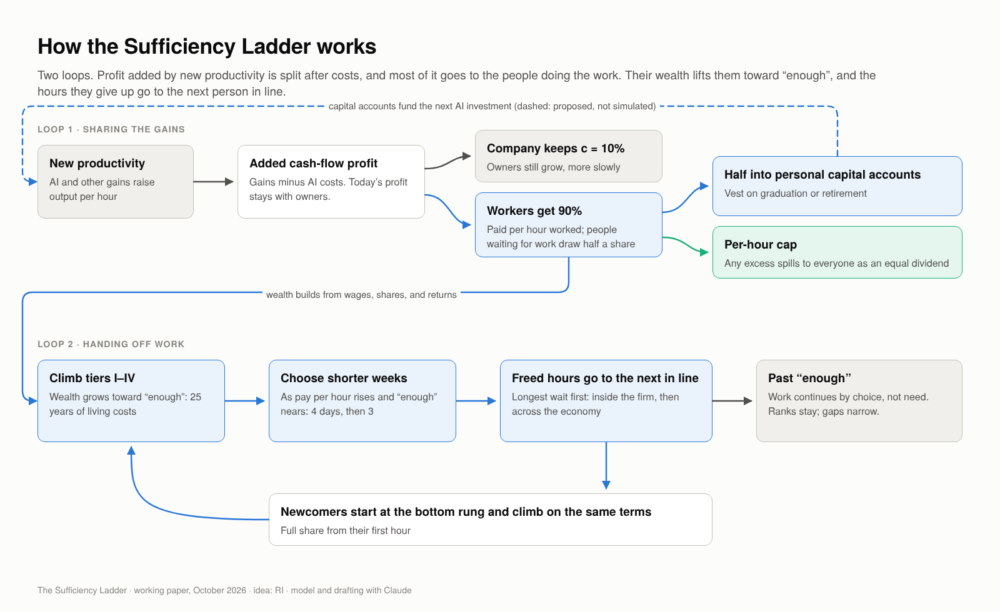
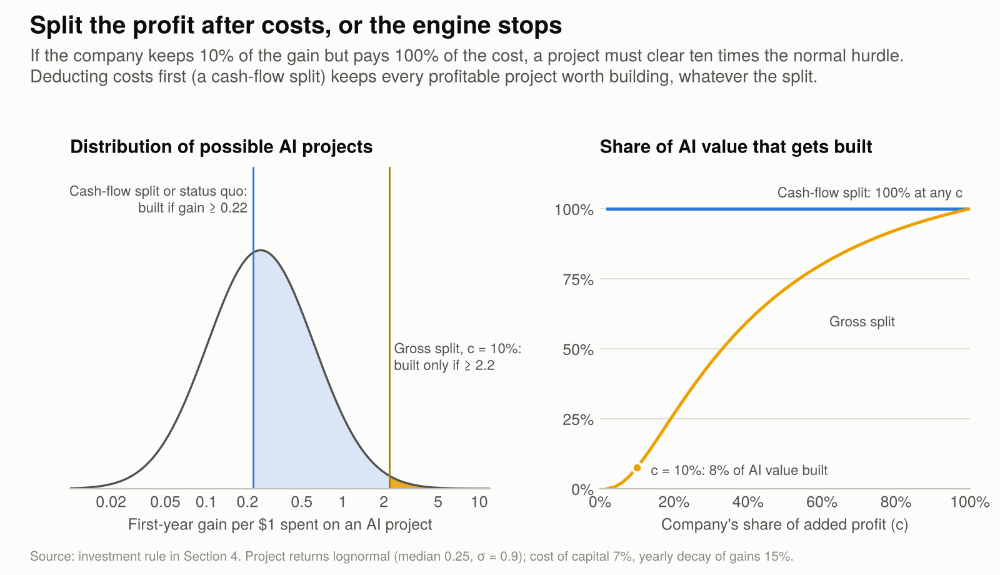
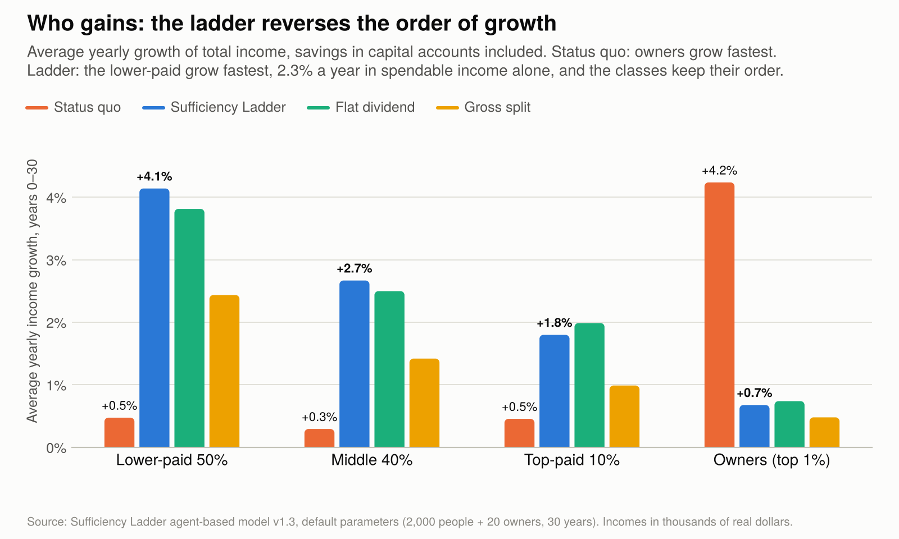
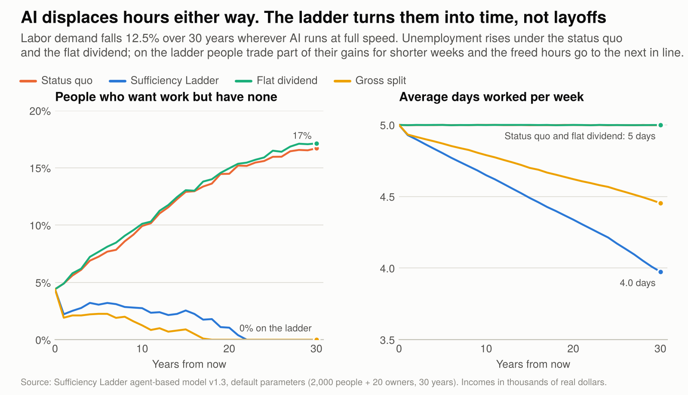

# Keynes Promised Us Time. AI Is Our Second Chance.

*A proposal for sharing AI's gains with the people doing the work, and a simulation of what happens if we do.*

RI · 27 October 2026 · first published on [Substack](https://rinsite.substack.com/p/keynes-promised-us-time-ai-is-our)

In 1930, John Maynard Keynes made a bet about us. He predicted that within a century, technical progress would make his grandchildren four to eight times richer, and he suggested they could then share out the remaining work in about fifteen hours a week. The economic problem would be solved, and people could turn to the harder question of how to live well.

It's 2026. The first half of the bet came roughly true. The second half didn't, at least not in the United States. Between 1979 and 2019, American productivity grew about 60%, while the pay of a typical worker grew about 16%. By the OECD's count, Americans still work about 1,800 hours a year and Germans about 1,330, though the OECD warns that its figures are meant for tracking each country over time, not for comparing countries.

The gains didn't vanish. They went mostly to the top: to the highest earners, and to shareholders.

Now AI is arriving, and we're standing at the same fork. It's the same question, only faster: who gets the gains?

The early evidence says the default answer hasn't changed. Researchers in Denmark followed 25,000 workers in jobs exposed to AI chatbots. Most of the time the chatbots saved went into other tasks, fewer than one in ten took it as breaks or time off, and by the workers' own account only 3 to 7% of the gain reached their pay.

## It wasn't always this way

From 1947 to 1973, real family income in the US grew 117% for the poorest fifth of families and 75% for the richest 5%. The bottom grew fastest, so the gaps shrank in relative terms. Union contracts like the 1950 "Treaty of Detroit" between General Motors and the autoworkers wrote productivity-linked raises into wages.

Some countries also took part of their gains as time. The Dutch, with about half of all jobs part-time, produce nearly as much per hour as Americans do.

So the outcome is a choice, not a law of nature.

## The idea: share the gains, then the hours

Here's the proposal I've been thinking about. I call it the Sufficiency Ladder.

1. When new technology raises a company's profits, the company keeps a fixed slice of the added profit, say 10%, and the rest goes to the people doing the work. Existing profits aren't touched; only the new gains are split.
2. Workers build wealth. As they approach "enough", meaning financial independence, they choose to work four days instead of five, then three.
3. The hours they give up go to the next person in line: first inside the company, then across the economy. Someone who needs the work gets it, and starts climbing too.
4. People move up the ladder the way students move through grades. At the top, money becomes a moot point, and the people who keep working do it because they want to.

In the simulation below, few people reach the top within 30 years. What most get is a growing cushion and a four-day week.

Owners still get richer, just more slowly than everyone below them. The ladder keeps the hierarchy of a market economy and narrows its gaps, the way the postwar decades did.

## Every piece already exists

I didn't want to reinvent the wheel, so I went looking for it first. Every part of this has been tried somewhere:

- **Gainsharing.** Scanlon plans, used since the late 1930s, typically give workers 75% of measured productivity gains.
- **Profit sharing by law.** France has required it since 1967.
- **Gains paid as ownership.** Sweden's Meidner funds (1983) put part of company profits into funds that bought shares on workers' behalf. They drew mass protests and were abolished after the 1991 election, partly because the funds were collective and union-influenced.
- **Personal capital accounts.** Mondragon's cooperatives in Spain hold members' profit shares in accounts paid out at retirement.
- **A right to work less.** The Netherlands gave workers a legal right to cut their hours in 2000.
- **Choosing time over money.** When German rail workers could choose a 2.6% raise, an hour less a week or six extra days off, most chose the days. In an early survey, about 260,000 German metalworkers said they would take eight extra days off instead of part of a bonus.
- **The next in line.** Denmark's job rotation puts an unemployed person in the seat of a worker who's away training.
- **Gains for everyone.** Alaska pays every resident a dividend from oil wealth, and employment didn't fall.

What nobody has done, as far as I can find, is wire these together: tie the profit share to a voluntary handoff of hours so the whole thing keeps moving people up on its own.

## The one design choice that makes or breaks it

My first version had a flaw. If the company keeps 10% of the gain but pays all the costs, it almost stops investing.

Say an AI system costs $1 million and adds $3 million in profit. If the company keeps 10% of the $3 million, it gets $300,000 back on a $1 million investment. It never buys the system, and workers get 90% of nothing.

The fix is old and proven: split the profit after costs. The added profit is then $2 million. The company keeps $200,000 on top of getting its money back, workers get $1.8 million, and the system gets built. Economists have known since 1948 that a tax on cash flow doesn't stop profitable investment. Norway taxes oil profits at a marginal rate of 78% with a tax designed this way, so that projects profitable before tax stay profitable after it. The design needs one more rule: losses have to be shared as fully as gains. Otherwise owners carry all the risk when a company fails, which is why Norway refunds the tax value of unused losses.

In the simulation, splitting gross gains at 10% means only 8% of the AI value that would otherwise be built still gets built. Splitting after costs keeps it at 100%, whatever the split.

## What the simulation shows

To test whether this holds together, I built an agent-based model with Claude: 2,000 people and 20 owners over 30 years. AI adds 1.5% a year to productivity growth, and some of its gains reduce the hours companies need. That 1.5% comes from a forecast for one decade, stretched here to 30 years; if the boost stops after ten, the results shrink but hold. The model compares four worlds: today's rules, the ladder, a flat dividend paid to everyone, and the ladder with the flawed gross split.

Within the model's assumptions about wages, investment and how easily jobs can be shared, three results stood out.

**The order of growth flips, and the hierarchy holds.** On the ladder, the lower-paid half's income grows 4.1% a year counting the savings locked in their accounts, or 2.3% counting only what they can spend. Owners' income grows 0.7%. Under today's rules it's the reverse: owners gain 4.2% a year and the lower-paid half 0.5%. In every year of all 248 runs, the classes stay in the same order. Owners go from earning 81 times as much as the lower-paid half to 29 times; under today's rules the gap widens to 243 times.

**Displaced hours become time, not layoffs.** AI cuts the hours companies need by about an eighth over 30 years. Under today's rules, unemployment climbs to 17%. A flat dividend doesn't fix that on its own: the checks arrive, but under today's job rules one person in six still has no work. On the ladder, unemployment reaches zero by year 22, and the average week shrinks to four days.

That comparison is unfair to the dividend, so I also ran a fairer one. Give the dividend the same right to cut hours and the same savings accounts, and it does about as well as the ladder. In the model, what does the work is the right to work less and the savings, not paying the share per hour.

**There's a price, and it's the one Keynes would have chosen.** Total output on the ladder ends up about 6% lower after 30 years, because people choose shorter weeks. Output per hour is identical. We'd be trading some stuff for time.

## Where it breaks

The model also showed me where the idea fails, which is the most useful thing a model can do.

- **When AI displaces a lot of work, a voluntary handoff isn't enough.** If more than about 43% of AI's gains show up as fewer hours needed, people waiting for work get stuck. An "admission rule" fixes it: when people are waiting, everyone shares hours, down to three days, to bring them in. With that rule, unemployment stays at zero for 30 years even when all of AI's gain shows up as fewer hours needed; after that, even a three-day week isn't short enough.
- **It runs on people choosing time.** If nobody trades money for time, the handoff comes too late and unemployment reaches 11%. The evidence from Germany and the Netherlands says people do choose time when it's safe to.
- **"Enough" might keep moving.** If people's sense of enough rises with everyone else's income, they mostly get four-day weeks rather than early financial freedom. If it stays put, many reach it, and then companies can't find enough workers. Rents can move it too: where housing is scarce, landlords capture much of any income gain, so the ladder works best alongside building more homes. That's the question Keynes got wrong, and it's still open.
- **Insiders protect themselves.** Mondragon protected its members while temporary workers took the hits. The ladder has to give newcomers the full share from their first hour.
- **Pools can split a workforce.** Samsung's 2026 chip deal pays bonuses out of the chip division's profits. Some memory workers may get about $400,000 this year and consumer-electronics staff about $4,000, and resentment has already slowed work in other divisions. The ladder's answer is a pool that covers the whole company, a cap per hour, and an overflow paid to everyone.
- **Someone owns the AI that fills the hours.** When people step back, AI will do much of the work they release. If a company inside the ladder owns that AI, its added profit is shared like any other. But if the systems belong to a few companies beyond the rule's reach, their profits concentrate again what the split just shared, and the ladder becomes today's economy with a shorter week. One answer is to treat AI as what it is, something built from everyone's work and data, and to own it more broadly.
- **Companies can dodge.** Mexico's mandatory profit sharing was undermined by outsourcing tricks until a 2021 reform. Any real version needs anti-avoidance rules from day one.

## What this isn't, and how it could start

It isn't universal basic income: the money is tied to work and time, and a dividend comes in only as overflow and backstop. As the simulation showed, a dividend with the same rights would do about as well. The case for tying the gains to work is practical: a company can start a version of it without a new tax or law, though the full system needs public rules too. Its cost is real: people who can't do paid work, such as many carers and disabled people, gain only through the overflow. It isn't socialism either: ownership stays private and owners keep today's profits. What they give up is most of the future growth, and share prices would reflect that. It's closer to what the postwar decades did by accident, done on purpose.

No one needs to pass a national law tomorrow. A company adopting AI could pilot it with gainsharing plus a pay-or-time choice, as Deutsche Bahn did. A state could offer tax advantages to firms that adopt the formula; California's governor has already asked state agencies to evaluate worker-ownership models and ways to share AI companies' revenue. Unions in AI-heavy industries could bargain for it, as Samsung's chip workers just did, though their deal also shows why the pool should cover the whole company.

## An invitation

I'm putting this out to be argued with. If you can break the idea, please do, and tell me how in the comments. That's how ideas get better.

The [full working paper](../paper/sufficiency-ladder-working-paper.pdf) has the literature review, the math behind the investment rule, the model and every sensitivity test. The simulator and all the code are in this repository, where you can check every number or take the model and try your own rules. AI models have reviewed it; no economist has yet. If you'd like to review it, say so in the comments on the post or open an issue here.

Keynes was right that we'd get rich. Whether we get the time is still up to us.

---

**[Try the Sufficiency Ladder simulator](https://aj-fyc.github.io/sufficiency-ladder/)**: change the assumptions yourself and see what happens.

*I developed this idea in conversation with Claude, Anthropic's AI model, which helped with the research, built the simulation and drafted this essay with me. The idea, and any mistakes in judgment, are mine.*
